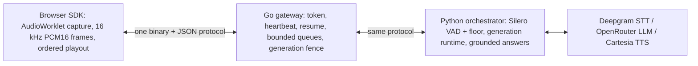

# VoiceCore Lab

A real-time voice agent for the [uv](https://docs.astral.sh/uv/) documentation, built to show the systems work underneath voice AI: browser audio capture and playout, a Go real-time gateway, turn-taking with an echo gate, barge-in that silences the agent, a grounded answer engine, and the tracing and benchmarks that measure all of it.

Speech-to-text, the language model and text-to-speech are bought (Deepgram nova-3, `openai/gpt-oss-120b` on Cerebras via OpenRouter, Cartesia sonic-3.6) through replaceable adapters. Everything between the microphone and the speaker is this repository's code. [ADR 0001](docs/adr/0001-engine-ownership.md) draws that line.



## Results (labelled; details and commands in each report)

<picture>
  <source media="(prefers-color-scheme: dark)" srcset="reports/latency_chart_dark.png">
  
</picture>

| What | Result | Label | Source |
|---|---|---|---|
| User stops speaking → first agent audio rendered | p50 841 ms, p95 1,520 ms (n = 15); 2,317 ms before tuning | live-provider | [reports/latency_tuning.md](reports/latency_tuning.md) |
| …of which detecting the end of the turn (eager endpoint) | p50 340 ms; 6/27 early cutoffs merged before any audio played | live-provider | [ADR 0002](docs/adr/0002-turn-policy.md) |
| Same path with mock providers | p50 1,320 ms, p95 1,440 ms (n = 216) | fake-provider | [reports/perf.md](reports/perf.md) |
| Barge-in: user starts talking → agent audio stops | p50 303 ms (8/8 silenced), 0/4 false barge-ins on echo | live-provider | [reports/barge_in.md](reports/barge_in.md) |
| Gateway overhead per round trip (two passes) | 0.19 ms median | measured, loopback | [benchmarks/transport.md](benchmarks/transport.md) |
| Grounded answers on held-out questions (gpt-oss-120b) | refusals 14/15 right, citations 12/12 supporting | live-provider | [reports/docs_eval.md](reports/docs_eval.md) |
| Adversarial docs (stale, contradicting, injected, unauthorised) | 14/15 pass, 0 leaked claims | live-provider | [reports/docs_eval.md](reports/docs_eval.md) |
| STT word error rate, held-out audio | 6.5 % (n = 25) | live-provider | [reports/quality_eval.md](reports/quality_eval.md) |
| Concurrent sessions, mock providers | 40/40 complete, p95 1,305 ms, 0 drops | fake-provider | [reports/perf.md](reports/perf.md) |

Samples are small (10–30 live turns per number), so these rank design choices; they are not production rates. The hosted Deepgram Voice Agent measured 972 ms (n = 3, [reports/latency_breakdown.md](reports/latency_breakdown.md)); what closed the gap is in [reports/latency_tuning.md](reports/latency_tuning.md).

## Quick start (no keys, no spend)

```bash
docker compose up --build        # gateway :8080, orchestrator, demo :5173 — mock speech and language providers
open http://localhost:5173       # "Ask the uv docs" widget; /?lab=1 shows a session timeline
uv run python harness/smoke.py   # optional: one typed question over the WebSocket, expects a cited answer
```

The first build embeds the docs snapshot into the orchestrator image (a few minutes).

## Develop

Requirements: Go ≥ 1.25, Node 24 with pnpm 11, Python 3.12 with [uv](https://docs.astral.sh/uv/), ffmpeg (only to rebuild audio fixtures).

```bash
uv sync && pnpm install
make test        # Go (race + synctest), Python (pytest, fake time), TypeScript (vitest): no network, no spend
make e2e         # Playwright (Chromium fake mic): capture, gateway round trip, voice turn, widget, lab panel, WebRTC spike
uv run python harness/gate.py   # the CI latency/quality regression gate (fake time)
```

Run the pieces by hand: `go run ./cmd/gateway` (in `services/realtime-gateway`), `uv run python -m voicecore.server` (mock providers), `pnpm --filter @voicecore/demo dev`.

### Live providers (spends money)

Copy `.env.example` to `.env` and fill in the keys, then `uv run python -m voicecore.server --providers live` (or `PROVIDERS=live docker compose up`).

- **Spending is guarded.** Every live session reserves its caps first (STT 120 s of speech, LLM $0.006, TTS 1,500 characters) in `benchmarks/spend_ledger.json`, and [`voicecore/budget.py`](services/agent-core/voicecore/budget.py) refuses anything over the project caps.
- **Keys stay on the server.** The browser only ever holds a 60 s gateway token.

## Repository map

| Path | What |
|---|---|
| [`packages/protocol/`](packages/protocol/SPEC.md) | wire protocol spec, golden vectors, TS codec |
| [`packages/web-sdk/`](packages/web-sdk/src) | capture (resampler, framer), `VoiceClient`, playout with generation fence, headless Node client |
| [`services/realtime-gateway/`](services/realtime-gateway) | Go gateway: sessions, resume, queues, counters, traces; `cmd/wsload`, `cmd/fakeorch` |
| [`services/agent-core/voicecore/`](services/agent-core/voicecore) | `turntaking/` (VAD, floor, echo gate), `runtime/` (generations), `providers/`, `answer/` (ingest, hybrid retrieval, grounding), `server.py` |
| [`apps/demo/`](apps/demo) | landing page, embeddable widget (`voicecore.js`), `?lab=1` timeline panel, Playwright suites |
| [`harness/`](harness) | fixture builders, runners (in-process fake time, WSS), timeline and metrics, benchmarks, evals, CI gate |
| [`experiments/`](experiments) | RTP jitter buffer and RFC 3550 jitter; Pion WebRTC spike |
| [`fixtures/`](fixtures) | LibriSpeech-derived audio (CC BY 4.0, [attribution](fixtures/audio/ATTRIBUTION.md)), uv docs snapshot (MIT/Apache-2.0), answer key, adversarial docs |
| [`docs/`](docs) | [architecture](docs/architecture.md), [portfolio story](docs/portfolio_story.md), [media internals](docs/media_internals.md), ADRs, step plans |

## Status and open items

All eight build steps are done. These items need a person or a decision:

- the dummynet (`sudo`) network-shaping runs;
- the manual acoustic barge-in and speaker/AEC checks;
- the 20-answer manual audit ([reports/answer_audit.md](reports/answer_audit.md));
- hosting a public demo;
- making the repository public.

[EXECUTION_STATUS.md](EXECUTION_STATUS.md) tracks every step with its evidence.

For coding agents: start with [MASTER_AGENT_GUIDE.md](MASTER_AGENT_GUIDE.md) and [CLAUDE.md](CLAUDE.md). The build plan is [docs/IMPLEMENTATION_PLAN.md](docs/IMPLEMENTATION_PLAN.md).
