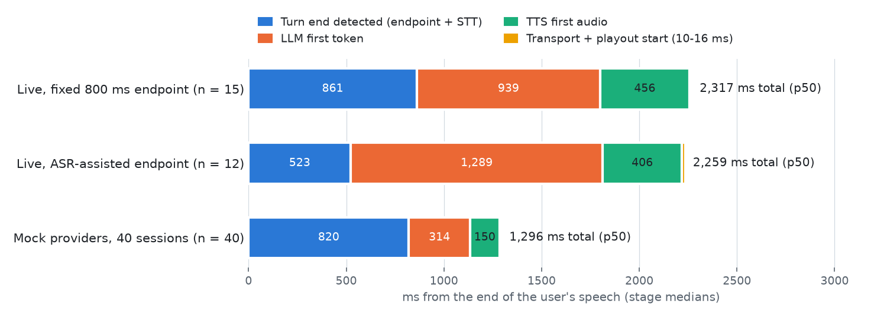

# VoiceCore Lab

**A voice assistant you can talk to, and interrupt, built from the microphone to the speaker and measured at every step.**

**Try it:** [voicecore-docs.fly.dev](https://voicecore-docs.fly.dev) (click "Ask the docs" and speak or type). **Results at a glance:** [voicecore-docs.fly.dev/results](https://voicecore-docs.fly.dev/results). **Console demo:** [voicecore-docs.fly.dev/console/](https://voicecore-docs.fly.dev/console/) (read-only).

You ask a documentation website a question out loud. VoiceCore listens, works out when you have finished speaking, finds the answer in the docs, and speaks it back with a link that opens the exact section it came from. The live median is **0.84 seconds** from the end of your question to the start of its answer. If you start talking while it is speaking, it goes quiet in about **0.3 seconds**.

The three AI models are rented through small, swappable adapters: speech-to-text (Deepgram), the language model (gpt-oss-120b on Cerebras, via OpenRouter) and text-to-speech (Deepgram Aura-2). **Everything between the microphone and the speaker is written in this repository:**
- the browser audio code;
- the network protocol;
- a Go real-time server;
- the logic that decides who is speaking;
- interruption handling;
- a search and citation engine;
- the tracing, tests, benchmarks and production tooling that prove it works.


## How one question flows


1. **The browser** cuts your voice into 20 ms frames and streams them over one WebSocket.
2. **The Go gateway** checks their order, keeps every queue bounded and forwards them.
3. **The orchestrator** hears you stop, gets the transcript, searches the docs and asks the model for an answer with citations.
4. **Each sentence is spoken as soon as it is cited**, while the model is still writing the next one.
5. **If you interrupt**, every hop drops the old answer's audio by its generation number, and the agent goes quiet in about 0.3 s.

The [architecture guide](docs/architecture.md) walks through each step with more diagrams: the audio path, interruption, the answer pipeline, session security, scaling and observability.

## At a glance

| | |
|---|---|
| **Response time** | 841 ms median from the end of a question to the first sound of the answer (live, down from 2,317 ms after tuning) |
| **Interruptions** | 8 of 8 silenced, median 303 ms; 0 of 4 false interruptions caused by the agent's own echo |
| **Honest answers** | every answer sentence must cite a docs passage; held-out set: 14 of 15 correct answer-or-decline decisions, 12 of 12 citations support their claim |
| **Attack resistance** | stale, contradicting and prompt-injected pages: 0 harmful claims leaked into answers |
| **Load** | one orchestrator holds 50 concurrent voice sessions with under 5 ms of event-loop lag (mock models) |
| **Tests** | about 370 automated tests in Go, Python and TypeScript, plus a CI gate that fails a pull request when latency or answer quality regresses |
| **Cost** | the whole project was built and measured for about $1 of real model spend, enforced by a budget ledger |

Every number links to its report below and carries a label: `live-provider` (real models), `fake-provider` (scripted models), `simulated` or `target`. Samples are small (6–37 live turns), so they compare designs rather than promise production rates.

## What this project covers

Each area links to a deeper explanation in the [project tour](docs/portfolio_story.md).

| Area | In one line |
|---|---|
| [**Real-time audio**](docs/portfolio_story.md#1-real-time-audio-in-the-browser) | AudioWorklet capture, a hand-written resampler, 20 ms frames, ordered playback that can be flushed instantly |
| [**Networking and protocols**](docs/portfolio_story.md#2-a-wire-protocol-shared-by-three-languages) | one binary + JSON protocol across two hops, conformance vectors checked in TypeScript, Go and Python, fuzzed |
| [**Concurrent backend systems**](docs/portfolio_story.md#3-the-go-real-time-gateway) | a Go gateway with bounded queues, heartbeats, 10 s session resume and 0.19 ms of added latency |
| [**Conversation design**](docs/portfolio_story.md#4-turn-taking-knowing-when-you-have-finished) | voice activity detection, end-of-turn policies chosen by measurement, an echo gate |
| [**Interruption (barge-in)**](docs/portfolio_story.md#5-barge-in-stopping-mid-sentence) | "generation fencing": stale audio is dropped at every hop, so the agent stops mid-word |
| [**Streaming AI orchestration**](docs/portfolio_story.md#6-the-streaming-orchestrator) | speech-to-text, LLM and text-to-speech run overlapped in Python asyncio, with retries and recovery |
| [**Retrieval and grounding (RAG)**](docs/portfolio_story.md#7-grounded-answers-with-citations) | keyword + vector hybrid search, every sentence released only with a valid citation |
| [**AI safety**](docs/portfolio_story.md#8-defending-against-prompt-injection) | prompt-injection and misinformation defence enforced in code, not by asking the model |
| [**Evaluation**](docs/portfolio_story.md#9-evaluation-proving-quality-with-numbers) | held-out sets, adversarial sets, word error rate, a 22-case assistant eval, a manual audit plan |
| [**Performance engineering**](docs/portfolio_story.md#10-performance-from-23-s-to-084-s) | a stage-by-stage latency budget; 2.3 s cut to 0.84 s with three measured changes |
| [**Testing strategy**](docs/portfolio_story.md#11-testing-real-time-code-without-flaky-tests) | fake clocks, an in-memory network, property tests, chaos scenarios, a fake microphone in Playwright |
| [**Observability**](docs/portfolio_story.md#12-observability-seeing-inside-a-live-call) | one trace timeline across three processes; Prometheus, Grafana, Loki, alerts with runbooks |
| [**Reliability**](docs/portfolio_story.md#13-reliability-when-things-break) | circuit breakers, reconnects, deadlines, graceful shutdown that lets calls finish |
| [**Security and abuse protection**](docs/portfolio_story.md#14-security-and-abuse-protection) | single-use IP-bound tokens, resume keys, Turnstile, CSP, origin checks, CI secret and dependency scanning |
| [**Cost control**](docs/portfolio_story.md#15-cost-control) | every paid call reserves money first; hard caps, daily caps, a free text-only fallback |
| [**Scaling**](docs/portfolio_story.md#16-scaling-to-several-machines) | two gateways and two orchestrators behind nginx with shared Redis state; load and 30-minute soak tests |
| [**Delivery and operations**](docs/portfolio_story.md#17-delivery-and-operations) | Docker Compose, five CI workflows, a live Fly.io deploy, incident write-ups |
| [**Media internals**](docs/portfolio_story.md#18-media-internals-webrtc-and-rtp) | an RTP jitter buffer (RFC 3550), a Pion WebRTC spike, WebSocket vs WebRTC measured |
| [**Product and frontend**](docs/portfolio_story.md#19-the-product-a-docs-site-that-talks) | an embeddable widget, a Docusaurus docs site that scrolls to and highlights the cited section |
| [**Platform and developer experience**](docs/portfolio_story.md#20-the-platform-any-team-in-ten-minutes) | `npx create-voicecore`, a self-hosted console (agents, docs upload or Git, publish, test, embed), control plane / data plane split, measured time to first answer |

## Results

<picture>
  <source media="(prefers-color-scheme: dark)" srcset="reports/latency_chart_dark.png">
  
</picture>

| What | Result | Label | Source |
|---|---|---|---|
| End of your question → first sound of the answer | p50 841 ms, p95 1,520 ms (n = 15); 2,317 ms before tuning | live-provider | [latency tuning](reports/latency_tuning.md) |
| …of which: deciding you have finished | p50 340 ms; 6 of 27 early cut-offs merged before any audio played | live-provider | [ADR 0002](docs/adr/0002-turn-policy.md) |
| Same path with mock models | p50 1,320 ms, p95 1,440 ms (n = 216) | fake-provider | [perf](reports/perf.md) |
| You start talking → agent audio stops | p50 303 ms (8 of 8 silenced), 0 of 4 false interruptions | live-provider | [barge-in](reports/barge_in.md) |
| Time the gateway adds per round trip | 0.19 ms median | measured, loopback | [transport](benchmarks/transport.md) |
| Grounded answers on held-out questions | right answer-or-decline 14 of 15; citations supporting 12 of 12 | live-provider | [docs eval](reports/docs_eval.md) |
| Docs-site assistant, 22 scripted cases | small talk 4 of 4; off-topic 4 of 4 declined; docs questions 14 of 14 cited, 10 of 14 opened the predicted page | live-provider | [assistant eval](reports/assistant_eval.json) |
| Adversarial pages (stale, contradicting, injected, unauthorised) | 14 of 15 pass, 0 leaked claims | live-provider | [docs eval](reports/docs_eval.md) |
| Speech-to-text word error rate, held-out audio | 6.5 % (n = 25) | live-provider | [quality eval](reports/quality_eval.md) |
| Concurrent sessions, one orchestrator | 50 of 50 answered, loop lag p99 4.8 ms; 100 sessions need two copies | fake-provider | [load](reports/load.md) |
| 30-minute soak, 1,390 sessions | no failed round; memory growth under 5 % per process | fake-provider | [load](reports/load.md#soak) |

The hosted Deepgram Voice Agent, measured as a baseline, took 972 ms (n = 3, [breakdown](reports/latency_breakdown.md)). The [tuning report](reports/latency_tuning.md) shows what closed the gap: a faster end-of-turn decision, a faster model route and a pre-opened voice connection.

## Use it for your own docs

```bash
npx create-voicecore    # checks Docker, starts it, prints the dashboard's address and password
```

In the dashboard: add your Deepgram and OpenRouter keys on the Voice page, create an agent, upload your Markdown (or point it at a Git folder), press Publish, try it on the Test tab, and paste the one-line snippet into your site. Without keys it answers typed questions from your docs, at no cost. The [install guide](apps/docs/docs/getting-started/install.md) has the details, the [control-plane page](apps/docs/docs/architecture/control-plane.md) the design.

## Run it yourself (no keys, no spend)

```bash
docker compose up --build          # gateway :8080, orchestrator, docs site :3000, demo :5173, with mock models
open http://localhost:3000         # the docs site; "Ask the docs" answers from it and opens the cited section
open http://localhost:5173/?lab=1  # a live timeline of every stage of a call
uv run python harness/smoke.py     # optional: one typed question over the WebSocket, expects a cited answer
```

The first build embeds the docs into the orchestrator image, which takes a few minutes.

With mock models, the system behaves the same but answers are scripted. To use real models, copy `.env.example` to `.env`, add the keys, and run `PROVIDERS=live docker compose up`. Real calls reserve their cost first and are refused past the caps; provider keys never reach the browser, which only holds a single-use 60-second token.

## Develop

Requirements: Go ≥ 1.25, Node 24 with pnpm 11, Python 3.12 with [uv](https://docs.astral.sh/uv/), and ffmpeg (only to rebuild audio fixtures).

```bash
uv sync && pnpm install
make test                       # Go (race detector, fake time), Python (pytest, fake time), TypeScript (vitest): no network, no spend
make e2e                        # Playwright with Chromium's fake microphone: capture, round trip, voice turn, widget, lab panel, WebRTC
uv run python harness/gate.py   # the CI latency and quality regression gate
```

Run the pieces by hand:
- the gateway: `go run ./cmd/gateway` in `services/realtime-gateway`;
- the orchestrator: `uv run python -m voicecore.server` (add `--providers live` for real models);
- the docs site: `pnpm --filter @voicecore/docs start`;
- the demo: `pnpm --filter @voicecore/demo dev`.

**Production tooling, all local:**
- `docker compose --profile monitoring up -d --build --wait` starts Prometheus, Alertmanager, Loki and Grafana (:3001).
- `docker compose --profile scale up` runs two gateways and two orchestrators behind nginx, sharing Redis.
- The checks are `make monitoring-check`, `make monitoring-test`, `make scale-test` and `make fly-image-test`; the last three need Docker.

## Where to read next

| If you have | Read |
|---|---|
| 5 minutes | this page |
| 15 minutes | the [project tour](docs/portfolio_story.md): every area, the hard part, the decision, the proof |
| 30 minutes | the [architecture guide](docs/architecture.md), then the three write-ups: [the agent interrupted itself](docs/writeups/01-false-barge-ins.md), [a model that follows injected instructions](docs/writeups/02-grounding-under-attack.md), [860 ms of silence on purpose](docs/writeups/03-endpointing-tradeoff.md) |
| an operations interest | [runbooks](docs/ops/runbooks.md), [monitoring](docs/ops/monitoring.md), [service targets](docs/ops/slos.md), [incidents](docs/ops/incidents.md), [deploy guide](docs/ops/deploy.md) |
| a media interest | [media internals](docs/media_internals.md) and the [telephony design](docs/telephony_extension.md) |
| a question about a word | the [glossary](GLOSSARY.md) |

Design decisions are recorded as ADRs (architecture decision records): [what is built vs rented](docs/adr/0001-engine-ownership.md), [the turn-taking policy](docs/adr/0002-turn-policy.md), [observability](docs/adr/0003-observability.md), and [deploy, abuse, resilience and scale](docs/adr/0004-deploy-abuse-resilience-scale.md).

## Repository map

| Path | What |
|---|---|
| [`packages/protocol/`](packages/protocol/SPEC.md) | the wire protocol spec, golden test vectors, TypeScript codec |
| [`packages/web-sdk/`](packages/web-sdk/src) | browser capture (resampler, framer), `VoiceClient`, playout with the generation fence, a headless Node client |
| [`services/realtime-gateway/`](services/realtime-gateway) | the Go gateway: sessions, resume, queues, breakers, metrics, traces; `cmd/wsload`, `cmd/fakeorch` |
| [`services/agent-core/voicecore/`](services/agent-core/voicecore) | the Python orchestrator: `turntaking/`, `runtime/`, `providers/`, `answer/`, budget, metrics, `server.py` |
| [`apps/docs/`](apps/docs) | the Docusaurus docs site, which is the assistant's only knowledge source |
| [`apps/demo/`](apps/demo) | landing page, embeddable widget (`voicecore.js`), `?lab=1` timeline panel, Playwright suites |
| [`services/console/`](services/console), [`apps/console/`](apps/console) | the self-hosted console: FastAPI API (agents, sources, builds, keys) and its React UI |
| [`packages/create-voicecore/`](packages/create-voicecore) | the one-command installer and its compose template |
| [`harness/`](harness) | fixture builders, runners, timeline, benchmarks, evals, load and soak, the CI gate |
| [`monitoring/`](monitoring) | Prometheus rules and tests, Alertmanager routes, Loki, Alloy, the Grafana dashboard |
| [`deploy/`](deploy) | the Fly.io image and config, the platform images, the scale profile's nginx |
| [`experiments/`](experiments) | RTP jitter buffer and RFC 3550 jitter; Pion WebRTC spike |
| [`fixtures/`](fixtures) | LibriSpeech-derived audio (CC BY 4.0, [attribution](fixtures/audio/ATTRIBUTION.md)), a uv docs snapshot, answer keys, adversarial pages |
| [`docs/`](docs) | architecture, project tour, ADRs, write-ups, operations, step plans |
| [`reports/`](reports), [`benchmarks/`](benchmarks) | every measured result, with the command that produced it |

## Status and honest limits

- **Built:** Steps 00–10, from browser audio through production readiness and a self-hosted platform. CI runs on every push: tests, end-to-end tests, the latency and quality gate, Docker profiles and security scans.
- **One small machine.** The live demo runs on one Fly.io machine that stops when nobody is using it, so the first visit after a quiet spell waits a few seconds while it starts. Visitor spend is capped at $0.50 a day and $2 in total; past that, answers come back in text. Each session speaks about 15 answers, then switches to text.
- **Waiting on a person:**
  - a live load test (about $0.17);
  - network-shaping runs that need `sudo`;
  - manual acoustic and echo checks;
  - a 20-answer manual audit.
- **Small samples.** Live numbers come from 6–37 turns each, on one laptop over a home connection.

[EXECUTION_STATUS.md](EXECUTION_STATUS.md) records every step with its evidence. Coding agents start at [MASTER_AGENT_GUIDE.md](MASTER_AGENT_GUIDE.md) and [CLAUDE.md](CLAUDE.md).
