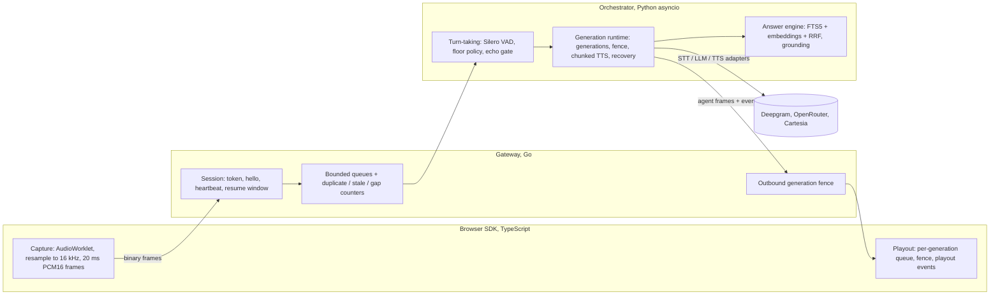

# Architecture

VoiceCore Lab is three processes and one protocol. Each process owns one thing:

- **the browser** owns the audio devices;
- **the Go gateway** owns the connection;
- **the Python orchestrator** owns the conversation.

The design decisions are in [ADR 0001](adr/0001-engine-ownership.md) and [ADR 0002](adr/0002-turn-policy.md); the media path in detail is in [media_internals.md](media_internals.md).



## One protocol, two hops

[`packages/protocol/SPEC.md`](../packages/protocol/SPEC.md) defines both hops: browser ↔ gateway and gateway ↔ orchestrator.

- **Audio frames:** a 28-byte big-endian header (version, kind, flags, stream, sequence, capture time, generation, sample count) followed by PCM16 little-endian.
- **Control events:** JSON messages with a required-field table.
- **Conformance:** golden vectors in `vectors/` are checked by the TypeScript, Go and Python codecs alike.

## The rule that makes barge-in work: generation fencing

Every agent audio frame carries the `generation_id` that produced it. When generation *g* is cancelled (the user interrupts, types a new question, or reconnects), each queue owner sets `fence = g` and drops everything at or below it, including audio already queued:

- the orchestrator checks before every send;
- the gateway purges its client-bound queue when `agent.cancel` passes through;
- the browser playout flushes and acknowledges with `cancel.ack{played_until_seq}`.

The TTS adapter drops late audio too, because Cartesia only cancels requests that have not started. Measured: [reports/barge_in.md](../reports/barge_in.md).

## A voice turn

```mermaid
sequenceDiagram
  participant B as Browser
  participant G as Gateway
  participant O as Orchestrator
  participant X as Providers
  B->>G: mic frames (20 ms)
  G->>O: mic frames (sequence-checked)
  O->>X: speech audio only (300 ms pre-roll), STT
  O-->>B: user.speech_started
  Note over O: 800 ms of silence -> endpoint; Finalize STT
  O->>X: retrieve locally, then LLM (grounded prompt)
  X-->>O: tokens; sentences released only with a valid [n] citation
  O->>X: TTS per sentence (one context per generation)
  X-->>O: audio
  O->>G: agent frames (generation 1) + answer.sources + agent.text
  G->>B: agent frames
  B-->>O: playout.started / stopped (client clock)
```

## Failure handling (each has a test)

| Failure | Behaviour | Where |
|---|---|---|
| Network drop | gateway keeps the session and the upstream socket for 10 s; on resume it fences the old generation and the orchestrator cancels it | `session/`, `Session.on_event` |
| Client floods or misbehaves | bounded queues (drop oldest, counted), close codes 1007/1008/4001–4003 | gateway |
| STT returns nothing | reprompt after 5 s | `Session._after_endpoint` |
| LLM stall / HTTP 429 | reprompt after 8 s; backoff 1/2/4 s, then "I'm busy" | `Session._generate` |
| TTS failure | the text answer is delivered; one retry on a fresh stream if nothing was heard yet | `Session._retry_tts` |
| Mic revoked | that stream is ignored; text keeps working | `Session.on_event` |
| Budget exhausted | live adapters cannot be built without a reservation; per-session caps end the voice path | `budget.py`, `providers/factory.py` |

## Observability

Every process writes the same trace event shape (SPEC section 5): the gateway with `-trace`, the orchestrator per session, the client as logs. [`harness/session_timeline.py`](../harness/session_timeline.py) puts them on one clock (NTP-style ping/pong for the gateway, mic-frame timing for the orchestrator), and the demo's `?lab=1` panel draws the result. Text is never traced unless a run asks for it.

## Testing seams

| Seam | Tool |
|---|---|
| protocol | golden vectors in 3 languages + Go fuzz |
| gateway | `testing/synctest` over an in-memory `net.Pipe` network, goleak, `-race` |
| turn-taking | labelled fixtures, real Silero VAD |
| runtime | mock providers on fake time (looptime), hypothesis |
| providers | one contract suite, mock and `-m live` |
| answers | retrieval and grounding tests, live eval |
| browser | vitest (offline playout), Playwright with Chromium's fake microphone |
| whole stack | in-process runner on fake time (CI gate); WSS runner with headless SDK clients (benchmarks) |
