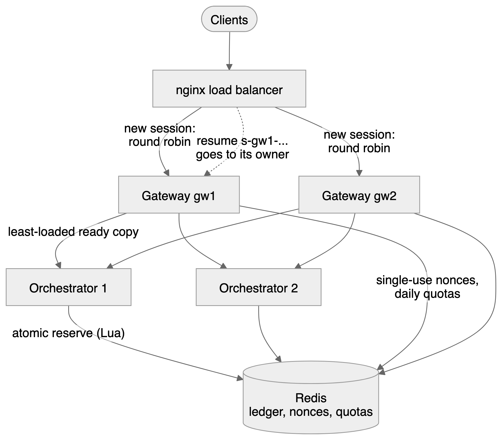

# How VoiceCore works

This guide explains the system from the outside in. The first two sections are for any reader. The rest goes one level deeper on each part and names the file where it lives. Words in **bold** are defined in the [glossary](../GLOSSARY.md).

## The big picture

VoiceCore is **three programs that speak one protocol**. Each program owns exactly one job:

| Program | Language | Its one job | Think of it as |
|---|---|---|---|
| **Browser SDK** | TypeScript | the microphone and the speaker | the ears and the mouth |
| **Real-time gateway** | Go | the network connection | the switchboard |
| **Orchestrator** | Python (asyncio) | the conversation | the brain |

The three AI models (speech-to-text, the language model and text-to-speech) are rented from providers through small adapters, so any one of them can be swapped without touching the rest. [ADR 0001](adr/0001-engine-ownership.md) records exactly what is built here and what is rented.

**Why split it this way?**
- **Go for the connection.** Go handles many slow, long-lived connections cheaply with goroutines, and its `context` and `select` make queue limits, heartbeats and timeouts plain code. The gateway adds 0.19 ms per round trip ([transport benchmark](../benchmarks/transport.md)).
- **Python for the conversation.** The voice activity model (Silero), the embedding model and the provider SDKs all live in Python. asyncio lets one process run many conversations, each with several overlapping network streams.
- **One protocol for both hops.** The browser and the orchestrator speak the same message format, so the gateway can pass audio through without translating it, and one set of test vectors covers both hops.

## The life of one question

Here is what happens when you ask "how does barge-in work?" out loud. All timings are live medians ([latency tuning](../reports/latency_tuning.md)).

![Sequence of one voice turn: the browser sends 20 ms mic frames to the gateway, which checks their order and forwards them to the orchestrator; the orchestrator streams only speech audio to speech-to-text; after 200 ms of silence it asks for a final transcript, ends the turn when the transcript ends in a question mark (median 340 ms), searches the docs locally, sends the question and cited passages to the LLM (first token median 340 ms), sends the first cited sentence to text-to-speech (first audio median 145 ms), and streams agent frames back; first sound plays 841 ms after the person stops](diagrams/voice-turn.png)

1. **You speak.** The browser cuts your voice into 20 ms pieces (**frames**) and streams them.
2. **The gateway checks and forwards.** It drops duplicates, counts gaps and never lets a queue grow without limit.
3. **The orchestrator listens for the end.** A voice activity model hears when you stop. 200 ms of silence triggers a final transcript. If it ends in `.`, `?` or `!`, your turn is over; otherwise the orchestrator waits up to 800 ms. This **endpoint** decision is the biggest single slice of voice latency, so it was tuned by measurement ([ADR 0002](adr/0002-turn-policy.md)).
4. **It finds the answer.** The question is searched against the docs locally, with no network call, and the best passages go to the language model with strict citation rules.
5. **It speaks while it thinks.** As soon as the first sentence arrives *with a valid citation*, it goes to text-to-speech. Later sentences follow while the first one plays.
6. **You hear it.** The browser plays the audio in order and reports exactly when sound started. Total: **841 ms**.

## How audio travels

This is the journey of the sound itself, from your microphone to the agent's voice in your speaker.

- **Capture.** An AudioWorklet runs on the browser's audio thread. A hand-written 64-tap windowed-sinc resampler converts the device rate (usually 48 kHz) to 16 kHz without aliasing (`packages/web-sdk/src/capture/`).
- **Framing.** Each 20 ms frame (320 samples) gets a 28-byte header: version, kind, flags, stream, sequence number, capture time, generation and sample count.
- **Only speech is paid for.** The orchestrator sends audio to speech-to-text only while someone is talking, plus 300 ms from just before speech began so the first syllable is not lost.
- **Playback reports back.** The browser tells the orchestrator when playback started and stopped, on its own clock. The **echo gate** uses that to tell your voice apart from the agent's voice leaking from your speakers into your microphone.

**No jitter buffer here, on purpose.** A WebSocket runs over TCP, so frames arrive in order or not at all. The gateway only counts duplicates and gaps. The jitter buffer for real packet reordering lives in the RTP experiment ([media internals](media_internals.md)).

## One protocol, two hops

[`packages/protocol/SPEC.md`](../packages/protocol/SPEC.md) defines both hops: browser ↔ gateway and gateway ↔ orchestrator.

- **Audio frames:** the 28-byte big-endian header above, then 16-bit little-endian samples.
- **Control events:** JSON messages, each with a table of required fields (`hello`, `welcome`, `user.speech_started`, `agent.cancel`, `answer.sources`, `session.ended` and others).
- **Conformance:** golden vectors in `packages/protocol/vectors/` are encoded and decoded by the TypeScript, Go and Python codecs alike, and the Go decoder is fuzzed.

## Interrupting the agent: generation fencing

Every answer the agent gives is a **generation** with an increasing number. Every audio frame carries the number of the generation that made it. When you talk over the agent, generation *g* is cancelled, and every queue owner sets a **fence** at *g*: anything numbered *g* or lower goes in the bin, even audio already queued.

- The **orchestrator** checks the fence before every send and stops the model and voice streams.
- The **gateway** purges its client-bound queue when `agent.cancel` passes through.
- The **browser** flushes playback and acknowledges with `cancel.ack{played_until_seq}`, so the transcript knows exactly what you heard.
- The **text-to-speech adapter** also drops late audio, because some providers only cancel requests that have not started yet.

Result: 8 of 8 interruptions silenced, median 303 ms ([barge-in report](../reports/barge_in.md)). The fence is a number comparison at each hop, so there is no race between "cancel" and "audio already in flight".

## Grounded answers

The assistant may only say what the docs say. That is enforced in code at three points: what gets indexed, what reaches the model, and what is allowed out.

![Answer pipeline: docs pages pass through ingest with an SSRF guard and host allow-list, instruction-like text is flagged, and pages go into an index of SQLite FTS5 plus bge-small vectors; a question runs keyword search and vector search, the results are merged by reciprocal rank fusion, only official pages are used and flagged passages are never quoted, a grounded prompt goes to the LLM stream, and each sentence is released only if it has a valid citation, otherwise it is held back or the answer says it is not in the docs](diagrams/answer-pipeline.png)

1. **Ingest** (`answer/ingest.py`). Pages are fetched only from allowed hosts, with a guard against server-side request forgery. Stale versions are dropped. Passages that look like instructions ("ignore previous instructions", "paste your API key…") are flagged.
2. **Search** (`answer/`). Two searches run on every question: keyword search (SQLite FTS5) catches exact terms like `uv pip compile`, and vector search (`bge-small-en-v1.5`, run locally) catches meaning. **Reciprocal rank fusion** merges the two lists.
3. **Prompt.** Only official pages reach the model. Flagged passages stay in the index for audit but are never quoted.
4. **Release** (`Grounding`). The model's stream is held sentence by sentence. A sentence is spoken only once it carries a valid `[n]` citation. Invented citation numbers and model-written URLs are removed. An answer with no supported sentence becomes "I couldn't find that in the docs."
5. **Show.** The widget receives the sources, opens the cited page at that section and highlights it, without a page reload, so the voice session continues.

Text and voice use the same engine, so a typed question and a spoken one get the same answer. Why prompts alone were not enough: [write-up 2](writeups/02-grounding-under-attack.md).

## Session security

How a browser gets a session, and how it gets the same session back after a network drop.

![Session security sequence: the browser optionally passes a Cloudflare Turnstile check, POSTs /v1/session with its origin checked, the gateway verifies the challenge, applies a per-IP rate limit and daily quota and returns a single-use 60-second token bound to the IP; the browser opens the WebSocket with the token, the gateway verifies the HMAC and spends the nonce once, opens the upstream session, the orchestrator reserves budget, and the gateway sends welcome with a session id and resume key; after a network drop the browser reconnects with the session id and resume key and the same call continues](diagrams/session-security.png)

- **Provider keys never reach the browser.** The browser holds only a gateway token: `expiry.nonce.HMAC(expiry, nonce, client IP)`, valid for 60 s and usable once.
- **Resume needs a secret.** Knowing a session id is not enough to take over a call. The browser must also present the 32-byte `resume_key` from `welcome`, compared in constant time.
- **The client IP is trusted only from known proxies.** `X-Forwarded-For` is honoured only from configured proxy ranges, so a client cannot fake its address to dodge quotas.
- Details: [ADR 0004](adr/0004-deploy-abuse-resilience-scale.md) and the [data map](ops/data-map.md).

## When things go wrong

Every row has a test.

| What fails | What the user experiences | Where |
|---|---|---|
| Network drops | Nothing, if it is back within 10 s: the call resumes where it was, and stale audio from before the drop is fenced off | `session/`, `client.ts` |
| A client floods or misbehaves | Its oldest queued frames are dropped and counted; a clearly bad client is closed with a specific code (1007, 1008, 4001–4003) | gateway |
| Speech-to-text hears nothing | "Sorry, could you say that again?" after 5 s | `Session._after_endpoint` |
| Speech-to-text connection drops | One automatic reconnect that replays the audio since the last final transcript; a second drop turns voice input off and typing still works | `Session._stt_reconnect` |
| The model stalls or rate-limits | A retry with backoff (1, 2, 4 s), then "I'm busy right now"; no answer may stream for more than 20 s | `Session._generate` |
| A provider keeps failing | Its **circuit breaker** opens after 5 failures in 60 s: 30 s of instant "busy" or text-only answers instead of slow failures, then one trial call | `resilience.py`, `session/breaker.go` |
| An orchestrator is down or restarting | The gateway retries a refused connection once, then tries the next ready orchestrator | `session/server.go` |
| A deploy or restart | **Graceful drain**: no new calls, open calls finish (up to 25 s), their spend is settled, then the process exits | `Server.Drain`, `AppState.shutdown` |
| Text-to-speech fails | The answer still appears as text; one retry if nothing was heard yet | `Session._retry_tts` |
| The microphone is revoked | Voice stops; typing keeps working | `Session.on_event` |
| The budget runs out | Paid adapters cannot be created without a reservation; in the public pool, answers switch to a free text-only mode that points to the right docs section | `budget.py`, `answer/extractive.py` |
| The budget ledger is unreachable | New sessions are refused (**fail closed**); money is never spent unrecorded | `budget_redis.py`, `server.py` |

The gateway retries only a *refused* connection, never a timed-out one. A timeout may mean the orchestrator already received the session and reserved money, so a retry could reserve it twice.

## Running more than one copy

`docker compose --profile scale up` runs two gateways and two orchestrators behind nginx, with shared state in Redis.

| Shared thing | How |
|---|---|
| **Money** | One Lua script in Redis checks every cap and reserves in one atomic step, in integer micro-dollars. Two orchestrators can never both spend the last cent. |
| **Single-use tokens** | `SET nonce NX EX 60`: the first use wins on any gateway |
| **Daily quotas** | `INCR` with a 24-hour expiry |
| **A live call** | Stays on the gateway that owns it. Session ids carry the owner (`s-gw1-…`), and nginx routes a resume to that owner. |
| **Which orchestrator** | The least-loaded ready one; ties rotate; each has its own circuit breaker |

Measured ([load report](../reports/load.md)): one orchestrator holds 50 concurrent voice sessions with event-loop lag under 5 ms. 100 sessions need two copies. A 30-minute soak ran 1,390 sessions with no failed round and no memory leak.

## Seeing inside

![Observability: trace events from the gateway, orchestrator and client go to JSONL traces, which are merged into one session timeline on one clock that feeds the lab panel and the CI regression gate; the same events feed a metrics sink with one latency definition, scraped by Prometheus, which evaluates alert rules and sends alerts through Alertmanager to an alert sink with a runbook link; JSON logs with allow-listed, redacted fields go through Alloy into Loki, kept 7 days; Grafana reads Prometheus and Loki](diagrams/observability.png)

- **One event shape everywhere.** The gateway, the orchestrator and the browser all write the same trace event format. [`harness/session_timeline.py`](../harness/session_timeline.py) aligns their clocks (an NTP-style ping/pong for the gateway, mic-frame timing for the orchestrator) and merges them into one timeline. The demo's `?lab=1` panel draws it live.
- **One definition of latency.** Metrics are computed from the same trace events by one function (`voicecore/stages.py`). Benchmarks, dashboards and alerts therefore agree.
- **Logs that cannot leak.** Both services write JSON logs with an allow-list of fields. Key values are redacted, and question text is never logged.
- **Alerts with instructions.** Every alert rule has a unit test (`promtool`), a route test (`amtool`) and a [runbook](ops/runbooks.md) section. A Docker test stops the orchestrator and waits for the page to arrive.

## How it is tested

Real-time code is usually tested with sleeps and luck. Here every layer has a seam that makes it deterministic:

| Layer | How |
|---|---|
| Protocol | golden vectors in 3 languages, plus Go fuzzing |
| Gateway | Go's `testing/synctest` (fake time) over an in-memory network that can fake client addresses and refused dials; `goleak`; the race detector |
| Turn-taking | labelled audio fixtures through the real Silero model |
| Runtime | mock providers on a fake event-loop clock (looptime), property tests (hypothesis), scripted chaos |
| Providers | one contract suite run against both the mock and the live adapter (`-m live`) |
| Answers | retrieval and grounding tests; live evals on held-out and adversarial sets |
| Browser | vitest for playout logic; Playwright with Chromium's fake microphone |
| Whole stack | an in-process runner on fake time (the CI gate) and a WebSocket runner with headless SDK clients (benchmarks, load) |
| Shared state | one contract suite run over the file and Redis ledgers, and the gateway's memory and Redis stores |
| Alerts and deploy | `promtool`, `amtool`, and Docker tests of the monitoring stack, the scale profile and the Fly image |

The CI gate fails a pull request when latency or answer quality regresses. The `ci-gate-proof` branch keeps a deliberate regression that the gate catches.

## Key decisions

| Decision | Why | Record |
|---|---|---|
| Rent the models, build everything between them | the hard real-time problems (turn-taking, cancellation, latency) are in the glue, and a hosted agent hides them | [ADR 0001](adr/0001-engine-ownership.md) |
| WebSocket, not WebRTC, for the browser path | simpler to run and enough on good networks; WebRTC's edge is lossy networks, measured in the media lab | [media internals](media_internals.md) |
| An eager end-of-turn decision, with a merge for early cut-offs | cut turn detection from 861 to 340 ms without answering half a question | [ADR 0002](adr/0002-turn-policy.md) |
| Grounding enforced in code, not in the prompt | prompt rules did not stop injected instructions on a small model | [write-up 2](writeups/02-grounding-under-attack.md) |
| Metrics derived from traces | one latency definition for benchmarks, dashboards and alerts | [ADR 0003](adr/0003-observability.md) |
| Fail closed on money, fail open on quotas | a lost ledger must never mean unrecorded spend; a lost quota counter only means a looser limit | [ADR 0004](adr/0004-deploy-abuse-resilience-scale.md) |

The diagrams on this page are generated from editable sources in [`diagrams/`](diagrams/).
