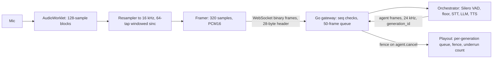

# Media internals (S07-T05)

How audio moves through VoiceCore, what each hop owns, and what was measured. Every number names its source; labels follow the [benchmark rules](../benchmarks/README.md).

## The path

| Hop | Owns | Code | Evidence |
|---|---|---|---|
| Capture | 16 kHz framing, PCM rule, no audio before consent | `packages/web-sdk/src/capture/` | Playwright fake-mic test; resampler zero-crossing and anti-alias tests |
| Wire | 28-byte big-endian header, PCM16 LE, control events | `packages/protocol/SPEC.md` | golden vectors in TS, Go and Python; Go fuzz |
| Gateway | duplicate/stale/gap rules, bounded queues, resume, fence | `services/realtime-gateway/session/` | synctest tests; `benchmarks/transport.md` (0.19 ms added RTT median) |
| Turns | VAD windows of 512 samples, floor, echo gate | `voicecore/turntaking/` | ADR 0002; `reports/turn_policy.*` |
| Playout | ordered render, cancel flush, `played_until_seq` | `packages/web-sdk/src/playout/` | offline-adapter tests; barge-in benchmark |
| RTP lab | jitter buffer with sequence unwrap, RFC 3550 jitter | `experiments/rtp/` | 4 unit tests incl. the hand-worked jitter value |
| WebRTC spike | Pion peer, ICE/DTLS log, Opus RTP into the jitter buffer | `experiments/cmd/pion-peer/` | Playwright `webrtc.spec.ts` |

## Why there is no jitter buffer on the WebSocket path

A WebSocket runs over one TCP connection, so frames arrive in order or not at all: a lost segment is retransmitted and everything behind it waits (head-of-line blocking). Reordering cannot happen, so the gateway only counts duplicates, stale frames and gaps across reconnects. The `simulated` proxy runs in `benchmarks/transport.md` show what jitter becomes on TCP: at 150 ± 50 ms one way, the median frame interarrival collapses to 0.04 ms because frames arrive in clumps. The browser playout therefore counts underruns by time rather than by sequence.

RTP over UDP is different: packets can arrive late, out of order, twice or never. `experiments/rtp.Buffer` plays packet *n* at first arrival + delay + 20 ms × *n*:
- packets that arrive before their play time are reordered,
- packets that arrive after it are counted late and dropped,
- a play time with no packet is counted lost (where packet-loss concealment would go),
- sequence numbers are unwrapped across 65535 → 0, so wrap-around is not mistaken for reordering.

## WebSocket vs WebRTC on loopback (S07-T03, `measured`, local only)

Command: `BENCH=1 pnpm --filter @voicecore/demo exec playwright test e2e/webrtc.spec.ts -g compare`. Chromium sends the same fake microphone file for 10 s over each transport to one Pion process, which timestamps arrivals on one clock. Raw: [`benchmarks/raw/webrtc_vs_ws_20261030T024016Z.json`](../benchmarks/raw/webrtc_vs_ws_20261030T024016Z.json).

| Transport | Payload | Packets | Interarrival p50 / p95 / p99 / max | RFC 3550 jitter | Late / lost |
|---|---|---:|---|---:|---:|
| WebRTC | Opus, Chrome's RTP sender | 1,002 | 20.06 / 20.41 / 20.61 / 21.2 ms | 0.26 ms | 0 / 0 |
| WebSocket (VoiceCore SDK) | PCM16 16 kHz, 28-byte header | 500 | 19.86 / 29.53 / 30.10 / 30.2 ms | 4.84 ms | 0 / 0 |

- **The difference is in the browser, not the network.** On loopback neither transport loses anything. WebRTC paces packets from Chrome's media thread. The SDK's frames come from an AudioWorklet that posts 128-sample blocks to the main thread, where 20 ms frames are cut and sent. Frames therefore leave in small bursts, and every few frames one waits for the next block, which gives the ~29.5 ms p95 interarrival.
- **Possible fix (not done):** cut and send frames inside the worklet, or send on a 20 ms timer.
- **Confounds, written down as the plan asks:**
  - The codecs differ (Opus 20 ms frames against raw PCM).
  - Chrome applies its audio processing (AEC, noise suppression, AGC) to both paths. Only the WebRTC path can adapt bitrate.
  - The WebSocket "timestamp" is the SDK's capture clock derived from the sample count, so its jitter reflects send-time jitter.
- **Not run: shaped networks.** The same comparison under dummynet delay and loss needs `sudo` (`benchmarks/README.md`). That is where UDP's late-and-lost behaviour and TCP's head-of-line stalls would separate. It is the open item of this step.

## What a production media path would change

- **Opus over the WebSocket** (about 10× less bandwidth than PCM16) once the transport, not capture, is the bottleneck.
- **Playback position events** from the client (see the `ponytail:` note in `Session._played_power`) so the echo reference survives underruns.
- **WebRTC for lossy networks.** Its jitter buffer, NACK and FEC exist for exactly the loss that TCP turns into stalls. The Pion spike shows the server side is small. The cost is ICE/TURN infrastructure.
- **Telephony** through an adapter, not the core: [`telephony_extension.md`](telephony_extension.md).
