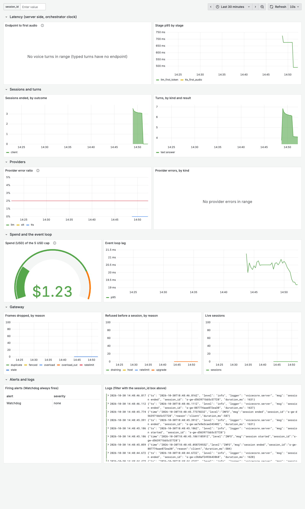
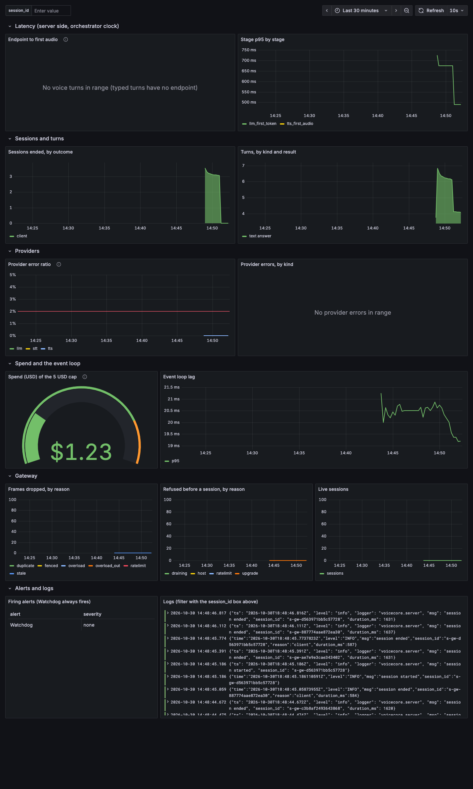

# Monitoring

**Status:** Step 09 Phase 5, 2026-10-30. Local and free: everything runs in Docker Compose on one machine.

## Start it

```sh
docker compose --profile monitoring up -d --build --wait
```

| What | Where | For |
|---|---|---|
| Grafana, dashboard "VoiceCore" | http://127.0.0.1:3001 (anonymous viewer) | the first place to look |
| Prometheus | http://127.0.0.1:9090 | queries, rule health, targets |
| Alertmanager | http://127.0.0.1:9093 | silences, what fired |
| The local pager | `docker compose logs -f alert-sink` | one JSON line per alert, `firing` and `resolved` |
| Orchestrator metrics | http://127.0.0.1:9464/metrics | raw |
| Gateway metrics and counters | http://127.0.0.1:9091/metrics, `/debug/counters` | raw |

Every port is bound to 127.0.0.1. The production overlay (Step 09 Phase 11) publishes none of them.

## How it fits together

- **Metrics.** The orchestrator computes its metrics from its own trace events (`voicecore/metrics.py`), so a latency stage means the same thing in Grafana as in the benchmark reports (`voicecore/stages.py`). The gateway exports its frame and refusal counters. Prometheus scrapes both every 5 s.
- **Alerts.** Rules in `monitoring/prometheus/alerts.yml`, one per target in [slos.md](slos.md), each linked to its [runbook](runbooks.md). Alertmanager groups them and sends every alert to the `alert-sink` container. To page a person, add a Slack or email receiver to `monitoring/alertmanager/alertmanager.yml`; none is configured, so no credentials are in the repo.
- **Logs.** Both services write JSON lines (`LOG_FORMAT=json`). Alloy ships every compose container's output to Loki, labelled `service`. Loki deletes logs after 7 days (compactor retention). The dashboard's logs panel filters on the `session_id` box.
- **Traces** stay JSONL files (`--trace-dir`); there is no tracing backend.

## The dashboard

Light and dark, after six mock text turns and one stopped orchestrator (`fake-provider`):




- **Endpoint to first audio** is empty here on purpose: typed turns have no endpoint, so only voice turns fill it.
- **Spend** reads the real ledger, so it shows the project's actual total ($1.23 on 2026-10-30), even in mock mode.

## Tests

- `make monitoring-check` runs `promtool check config`, `promtool test rules` (`monitoring/prometheus/tests/alerts_test.yml`: each alert fires on its target and stays quiet below it) and `amtool` config and route checks. No services needed.
- `make monitoring-test` brings the profile up and runs `harness/tests/test_monitoring.py`: three smoke turns appear in Prometheus, then `docker compose kill agent-core` pages the sink with `OrchestratorDown` `firing` and, after a restart, `resolved`. Local run 2026-10-30: 2 passed in 136 s. CI job `monitoring` runs both.
