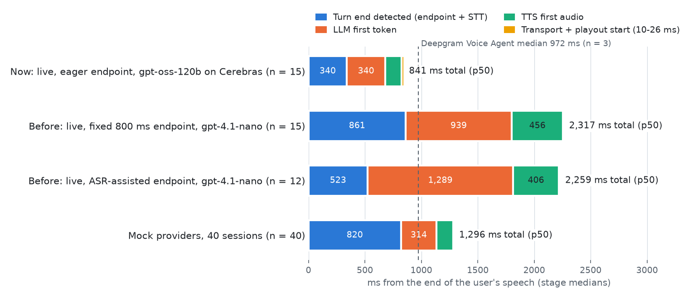

# Portfolio story: building a voice agent's engine room

**One line:** a voice assistant for the uv docs where I built everything between the microphone and the speaker, and measured it. The browser audio SDK, a Go real-time gateway, turn-taking with an echo gate, generation fencing for barge-in, a grounded answer engine, tracing, and a CI regression gate are mine. Speech-to-text, LLM and TTS are bought through adapters.

## Why this project

Hosted voice-agent products hide the hard part: when to start talking, how to stop instantly when interrupted, where every millisecond goes, and what happens when a provider stalls. I wanted evidence I could show for each of those. So the first thing I did was measure a hosted agent (Deepgram's Voice Agent API) as a baseline, and the last thing was to compare against it.

## What I built (and where to look)

| Area | What | Proof |
|---|---|---|
| Wire protocol | one binary + JSON protocol for two hops, golden vectors in 3 languages, fuzzed | `packages/protocol/` |
| Browser SDK | AudioWorklet capture, own 64-tap resampler, ordered playout with a generation fence | Playwright fake-mic tests |
| Gateway (Go) | sessions, 10 s resume, drop-oldest queues, counters, outbound fence, traces | 20+ `testing/synctest` tests, goleak; 0.19 ms overhead |
| Turn-taking | Silero VAD, fixed/adaptive/ASR-assisted endpointing, echo gate | ADR 0002 sweep + live check |
| Runtime | generations, fencing, chunked TTS, retries and backoff, recovery | property tests on fake time; 20-session chaos test |
| Answers | FTS5 + embeddings + RRF, citation grounding, injection and provenance defences | holdout + 2 adversarial sets, live |
| Evidence tooling | one timeline across 3 processes, lab panel, benchmarks, CI gate with a proof branch | `harness/`, `reports/` |
| Media lab | RTP jitter buffer (RFC 3550), Pion WebRTC spike, WS vs WebRTC on loopback | `experiments/`, `docs/media_internals.md` |

## Results, labelled

<picture>
  <source media="(prefers-color-scheme: dark)" srcset="../reports/latency_chart_dark.png">
  
</picture>

- **Live** (`live-provider`, n = 15): user stops speaking → first agent audio, **p50 841 ms / p95 1,520 ms**, down from 2,317 ms. [What changed](../reports/latency_tuning.md): an eager endpoint that merges early cutoffs (861 → 340 ms), gpt-oss-120b on Cerebras (LLM first token 939 → 340 ms) and a TTS socket opened before the first answer (456 → 145 ms).
- **Hosted baseline** (Deepgram Voice Agent, n = 3, not matched conditions): 972 ms to the first audio frame. The [breakdown](../reports/latency_breakdown.md) of the before state showed the gap was endpointing policy and the LLM hop, not the transport, which adds about 16 ms.
- **Barge-in** (live): 8/8 interruptions silenced, median 303 ms from speech onset; 0/4 false barge-ins after the fix in [write-up 1](writeups/01-false-barge-ins.md).
- **Answers** (live, holdout, gpt-oss-120b): refusal decisions 14/15, citations supporting 12/12. Adversarial: 14/15, with no adversarial claim in any answer. gpt-4.1-nano scored 15/15, 15/15 and 13/15 ([docs_eval.md](../reports/docs_eval.md)).
- **Load** (`fake-provider`): 40 concurrent sessions through the real gateway and orchestrator, p95 1,305 ms, 0 drops.
- **Budget:** the whole project ran on less than $1 of the $5 cap and about 13,700 Cartesia credits. A guard refused any spend outside a reservation.

## Things that went wrong (and what they taught me)

1. [The agent interrupted itself](writeups/01-false-barge-ins.md): a too-perfect fake hid a playback-clock drift, which a live run with a simulated room exposed.
2. [A small model follows injected instructions](writeups/02-grounding-under-attack.md): prompts and labels did not stop it, so trust is now enforced before the prompt.
3. [860 ms of silence, on purpose](writeups/03-endpointing-tradeoff.md): the fastest endpointing cut 1 in 5 live questions in half.
4. **Smaller ones:**
   - The fixture builder mixed a user 16 dB under the agent.
   - Streaming STT faster than real time lost the end of clips, inflating WER from 6.5 % to 9.9 %.
   - The first session loaded the VAD model inline and stalled its own audio.
   - A debug run committed a 10 MB binary; I removed it and moved builds out of evidence folders.

## What I would do next

- Playback-position events from the client, so the echo gate survives underruns.
- A punctuation + 500 ms endpoint policy, measured live.
- Moving VAD off the event loop, then profiling CPU to find the real session ceiling.
- Running the shaped-network comparison (needs `sudo`) where UDP and TCP should part ways.
