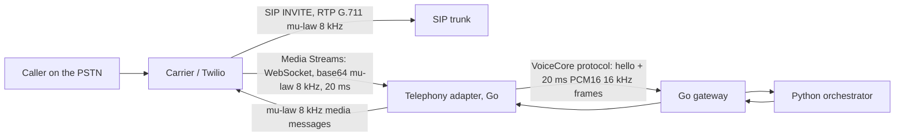

# Telephony extension: design only (S07-T04)

**Status:** design review, not built and not tested. VoiceCore makes **no SIP or PSTN claim**; this page describes what a phone path would need and where it would plug in.

## Where a phone call would enter

The cheapest real path is **Twilio Media Streams**: Twilio terminates SIP/RTP and sends the call audio over a WebSocket. A telephony adapter is then a thin translator in front of the existing gateway, and the gateway, orchestrator, turn-taking and generation runtime stay unchanged.

## SIP call flow (for a direct SIP trunk, not chosen)

1. Carrier → us: `INVITE` with SDP offer (PCMU/8000, often PCMA, maybe Opus); we answer `100 Trying`, `180 Ringing`, `200 OK` with our SDP (PCMU).
2. Carrier → us: `ACK`. RTP flows both ways (20 ms G.711 packets, 160 bytes); RTCP sender/receiver reports every ~5 s.
3. DTMF arrives as RFC 4733 telephone-event RTP packets (or SIP INFO).
4. Barge-in: we stop sending RTP for the cancelled generation. There is no client playout to flush: the carrier plays what it receives, so the **fence must act before audio leaves the adapter**, and the jitter buffer on our receive side is the `experiments/rtp` buffer.
5. Hang-up: `BYE` / `200 OK` from either side; the adapter sends `session.ended{reason:"client"}` upstream.

A direct trunk adds a SIP stack (registration, NAT traversal, re-INVITEs, session timers), media anchoring and carrier certification. That is the reason for the non-goal in ADR 0001.

## Twilio Media Streams adapter (the design)

| Concern | Twilio side | VoiceCore side | Adapter work |
|---|---|---|---|
| Session start | `start` message with `streamSid`, `callSid` | `hello` + dev token | mint a token server-side; map `streamSid` → `session_id` |
| Inbound audio | `media` messages, base64 μ-law 8 kHz, 20 ms | binary frames, PCM16 LE 16 kHz, 320 samples | μ-law decode (G.711 table), 8 → 16 kHz upsample, frame numbering, `capture_us` from Twilio `timestamp` |
| Outbound audio | `media` messages to Twilio, μ-law 8 kHz | agent frames PCM16 24 kHz with `generation_id` | 24 → 8 kHz downsample with a low-pass filter (the `Resampler` design from the SDK, ported), μ-law encode, 20 ms chunks |
| Barge-in | `clear` message flushes Twilio's buffered audio | `agent.cancel{gen}` | on `agent.cancel` send `clear`, drop queued frames ≤ gen (the same fence rule) |
| Playout progress | `mark` messages echoed back when audio has played | `playout.started/stopped` | send a `mark` after the first and last chunk of a generation; turn the echoes into `playout.*` events (this also gives the echo gate a real playback position) |
| DTMF | `dtmf` messages | none | map to `text.input` (e.g. "0" = operator) or ignore |
| End | `stop` | `session.ended` | close both sides |

**What changes in the core:** nothing in the protocol, gateway or runtime. The echo gate thresholds need a phone calibration, because phone echo comes from the handset and carrier, not laptop speakers. Endpointing at 8 kHz needs a re-run of the ADR 0002 sweep on telephone-band audio.

**Tests it would need before any claim:** a G.711 golden vector set (encode/decode); resampler tests at 8 kHz; a recorded Media Streams session replayed through the adapter (seam 9a); one real call recorded with consent. None of these exist.
