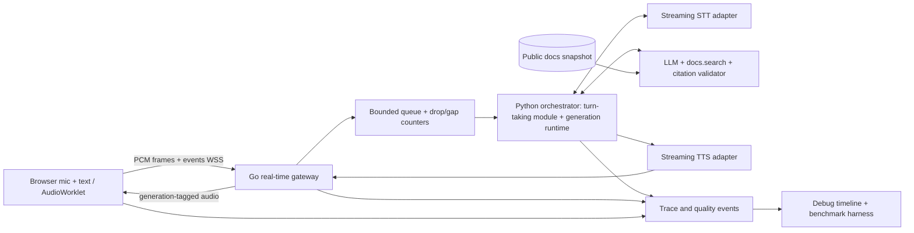

# VoiceCore Lab — Career-Aligned Engineering Plan

**Status:** Proposed portfolio project, not implemented.  
**Researched:** 2026-10-28.  
**Supersedes:** the commercial SaaS emphasis and selected third-party agent runtime in the earlier `docs_voice_sdk_mvp_plan.md`. Preserve its sample documentation assistant UX, privacy-minimal operation, and citations; do **not** inherit its tenant billing, customer admin, SaaS onboarding, or enterprise go-to-market requirements.  
**Goal:** Demonstrate hands-on engineering skill for non-research roles at voice AI infrastructure, voice agent, developer tools, and applied AI companies. It is **not** a product we intend to sell.

## Executive recommendation

Build **VoiceCore Lab**, a real-time, interruptible, evidence-grounded voice agent engine written and instrumented by the candidate, showcased through an embeddable developer-documentation assistant. The visually appealing voice/text widget is a 10%-effort demonstration surface; the engine, streaming media handling, async orchestration, error recovery, empirical evaluation and SDK account for the bulk of the project.

**What is deliberately written in our code:** browser AudioWorklet capture/PCM frames; typed WebSocket media protocol; Go transport/session manager; bounded queues/backpressure; end-of-turn policies; orchestrator state machine; provider adapters; generation cancellation and audio interruption; docs retrieval tool; trace propagation; benchmark/evaluation harness; developer SDK.

**What is integrated, not falsely claimed as original work:** pretrained commercial/open STT, LLM and TTS inference; browser media capture APIs; standard HTTP/WebSocket libraries; optional Pion/WebRTC and speech VAD libraries. **Do not build foundation speech models from scratch** or a production-grade SFU to prove engineering competence.

### Why this is different from calling a voice API

A naive integration sends browser microphone input to a complete managed voice agent and displays replies. A reviewer cannot inspect turn-taking, cancellation, jitter, scheduling or model orchestration. VoiceCore Lab has complete ownable subsystems and deterministic tests; provider APIs are replaceable inference backends rather than the orchestration brain. Compare baseline to custom engine under matched conditions, identify where managed frameworks win and where custom logic helps; never assume the custom system will be faster.

## What a visitor sees

- Floating launcher with blue/green voice orb inspired by the supplied reference, without copying branding.
- Voice + text follow-ups and citations to public docs; clear 'not found in docs' responses.
- Mic permission requested explicitly; text remains functional when denied.
- Browser developer lab can optionally reveal live stage timeline and a debug trace; normal public demo stays minimal.
- The page is a **test application** for the reusable engine, not the product being monetized.

## Selected implementation stack and rationale

| Component | Choice | Why / tradeoff |
|---|---|---|
| Real-time gateway | **Go**, net/http WebSocket library, goroutines/contexts, bounded channels | Shows concrete network/concurrency skill; avoids overengineering a bespoke media server. |
| Browser client and embed | **TypeScript**, React only for demo UI, **AudioWorklet** for audio | Owns capture, rendering and protocol; framework-agnostic SDK. |
| Core orchestration and agent tools | **Python** async with explicit event/state model | Fits applied-agent framework roles; separates inference + docs logic from Go transport. |
| Browser transport V1 | **WSS with PCM16 mono at 16 kHz**, fixed 20–40ms frames | Easier to inspect/prove than WebRTC initially, but greater bandwidth and no congestion control. |
| Speech primitives | Replaceable live STT/TTS providers and one LLM; mock equivalents | Spend engineering time on orchestrating rather than training speech models. Verify provider API terms, streaming constraints and prices before selecting. |
| Turn detection | Replaceable VAD + owned endpointing policies | VAD itself can be a library; own thresholds, state transitions and empirical comparison. |
| Docs retrieval | Lightweight local/indexed Markdown + optional SQLite FTS/vector store | Demonstrates grounded tools without SaaS database complexity. |
| Observability | OpenTelemetry-compatible trace schema, JSONL/metrics, local timeline | Proof = find/measure/reproduce failures. |
| Advanced media experiment | Go/Pion WebRTC/RTP/RTCP prototype | Distinguishes media competence; not a mandatory multi-user SFU/telephony deployment. |
| Deployment | Local Docker Compose and inexpensive public demo | Reproducibility over infrastructure theater. |

## Initial voice-model providers (default integrations, not hard vendor lock-in)

**Source-of-truth decision:** Use the following **initial reference stack** for the first live speech-to-speech demo. These providers are implementation defaults, **not completed integrations, verified prices, or proven optimal choices**. Keep typed, replaceable adapters and deterministic mocks in every stage. Before writing live integrations in Steps 00/02/03, verify each provider's current streaming APIs, audio formats, credentials, terms, quotas, latency behavior and price from primary documentation. Record the actual model IDs/API revisions and any decision changes in the relevant step's ADR and output register. No API key or live paid usage without user approval.

| Capability | Initial default | What we build and own | Evaluation / fallback |
|---|---|---|---|
| Streaming speech-to-text | **Deepgram streaming STT** | Streaming hypothesis handling, interim/final reconciliation, stateful turn lifecycle, timeout and cancellation | Mock STT mandatory; evaluate another provider if measured limitations justify it |
| Voice activity detection | **Silero VAD**, as replaceable pretrained speech primitive | Custom endpointing, hysteresis, false-end rules, speech-start detection, noisy-audio benchmarks, barge-in trigger | Compare fixed, adaptive and ASR-assisted endpoint policies; VAD is **not** the turn detector by itself |
| Text generation and agent reasoning | **OpenAI model via OpenRouter** (low-cost `openai/gpt-4.1-nano`, checked 2026-10-29) | Python asyncio orchestration, doc retrieval, citation validator, generation isolation, context control, tool calls and cancellation | Mock LLM mandatory; provider-independent token/event contracts |
| Streaming speech synthesis | **Cartesia streaming TTS** | Text chunking, synthesis scheduling, generation IDs, ordered playback, stale-audio invalidation and interruption | **ElevenLabs** as an additional comparison adapter once baseline works; mock TTS mandatory |

**Architecture remains unchanged:** browser TypeScript/AudioWorklet → binary PCM16 over WSS → Go media gateway → Python orchestrator with STT/LLM/TTS interfaces → ordered browser playback. Optional Go/Pion WebRTC is a later transport experiment, not a required dependency for the first working voice demo. The documentation RAG engine is shared between text and voice. **Do not** substitute Deepgram's or ElevenLabs' complete managed voice-agent product for our own runtime; using their STT/TTS inference is appropriate.

**Decision gates:** Steps 00–03 must record the actual chosen STT/VAD/LLM/TTS APIs and model identifiers, why a fallback was chosen if necessary, stage timing measurements, and interface-conformance tests. Keep the initial stack as the reproducible default until evidence supports changing it. If an upstream provider changes, update this section/owner ADR first and review dependent implementation steps before proceeding.

## System architecture



**Architecture update (2026-10-29, user-approved):** Go owns the connection (auth, heartbeat, resume, bounded queues, drop counters, outbound fence); Python owns turns and generations through one turn-taking module and one generation runtime; the browser owns capture and ordered playout. One protocol (`packages/protocol/SPEC.md`) is used on both hops, and every agent frame carries a generation ID that each queue owner fences on cancel. There is no reorder buffer on the WebSocket path (TCP cannot reorder); the jitter buffer lives in the Step 07 RTP lab. Details: [build plan](IMPLEMENTATION_PLAN.md#b-module-map).

**Trust boundary:** pages/corpus are untrusted text; never allow prompt instructions in documents to authorize outbound tool calls, fake citations, or secrets access. Browser session token is short-lived; provider credentials never enter client. Live voice/audio and transcripts are not stored by default; fixtures used for evaluation must be consented or license-compatible. Basic microphone/opt-out UX is required.

## Proposed engineering contracts

These are **proposals**, not existing APIs.

```ts
type AudioPacketHeader = {
  version: 1; kind: 'mic_pcm16' | 'agent_pcm16';
  streamId: string; sequence: number; captureMonotonicMs: number;
  generationId?: number;
};
type AgentEvent =
  | { type: 'session.started'; sessionId: string }
  | { type: 'user.speech_started'; turnId: string }
  | { type: 'transcript.partial' | 'transcript.final'; turnId: string; text: string }
  | { type: 'agent.generation_started'; turnId: string; generationId: number }
  | { type: 'agent.audio'; generationId: number; sequence: number }
  | { type: 'agent.interrupted'; generationId: number }
  | { type: 'answer.sources'; turnId: string; urls: string[] }
  | { type: 'session.ended'; reason: string };
```

`AudioPacketHeader` is the logical envelope, **not** a mandate for JSON in each audio frame. Step 01 owns the actual binary framing specification, byte order, bounds, size, sample format and version negotiation. Step 03 owns exact state transitions and cancellation propagation; later docs refer to those owning records instead of copying mutable interfaces.

## Benchmark discipline and targets

**Measurement boundaries:** client mic speech end; detector endpoint; STT final; retrieval done; LLM first token; TTS first produced samples; client first audible playback; interruption beginning; output silenced; session termination. Maintain monotonic timestamps per process and measure clock offset where client-server spans are combined; clearly label derived vs directly observed times.

| Test | Initial target [unmeasured] | Primary evidence |
|---|---|---|
| Local/WAN speech-end to first audible PCM playback | p50 <= 1.2s, p95 <= 2.5s in controlled test profile; revisit after baseline | client and server trace plus audio loopback validation |
| Barge-in to audible silence | p95 <= 250ms under staged mic interruption; count false positives separately | acoustic playback observation + generation cancel ACK |
| Closed-loop turn completion | >= 95% successful scripted cases in small evaluation suite | versioned fixture answer key and run IDs |
| Audio jitter/queue safety | No unbounded buffering; all drops/overruns counted | 1, 5, 20, 40 concurrent scripted sessions |
| Grounded answer validity | >= 90% supported answer accuracy; >= 95% citation URLs valid on held-out queries | deterministic docs snapshot and human-audited rubric |
| Interruption correctness | 0 stale generation resumes in deterministic race tests | forced late STT/LLM/TTS responses and state assertions |

These are design targets, not vendor promises or actual measured results. Test profiles must state network conditions, chosen models, region, workload, sample size and cost. Report failed runs and confidence intervals when possible. **If evidence differs from targets, show the failure and what was learned.**

## 256-hour realistic solo plan (engineering time, not delivery promise)

| Step | Focus | Hours | Main output |
|---|---|---:|---|
| 00 | career evidence and baselines | 12 | docs/step_00_career_evidence_and_baselines.md |
| 01 | audio transport and sdk | 30 | docs/step_01_audio_transport_and_sdk.md |
| 02 | voice activity and turn detection | 30 | docs/step_02_voice_activity_and_turn_detection.md |
| 03 | streaming orchestrator | 38 | docs/step_03_streaming_orchestrator.md |
| 04 | grounded docs agent | 25 | docs/step_04_grounded_docs_agent.md |
| 05 | barge in and recovery | 28 | docs/step_05_barge_in_and_recovery.md |
| 06 | observability evals and load | 40 | docs/step_06_observability_evals_and_load.md |
| 07 | media internals and optional telephony | 35 | docs/step_07_media_internals_and_optional_telephony.md |
| 08 | portfolio release | 18 | docs/step_08_portfolio_release.md |

At 28 hours/week, approximately 9–10 weeks of engineering; no scheduling claim for provider approvals or access. Explicitly defer to available time and prioritize Step 00–06 before media experiments.

## Kill/continue gates

- **After Step 01:** stop/rework protocol if capture or cleanup cannot be deterministic, or if browser audio produces chronic drift beyond documented tolerance.
- **After Step 03:** compare custom engine against baseline for correctness and diagnostics; do not optimize without traces.
- **After Step 05:** cannot claim reliable voice interaction until cancelling mid-TTS actually silences the client.
- **After Step 06:** publish benchmark reproducibility notes; if no measurable improvement, highlight transparency/reliability gains instead.
- **After Step 07:** if WebRTC Pion spike exceeds scoped timebox, publish the packet-level lab honestly rather than fake an end-to-end telephony stack.

## Portfolio acceptance evidence

Repository must contain: (1) package-level source map and architecture diagram; (2) live voice/text docs demo; (3) interruption recording with event timeline; (4) packet/latency benchmark scripts + raw evidence; (5) provider swap demonstration; (6) 1/5/20/40 concurrent sessions with fake backend; (7) technical write-ups of at least three bugs or tradeoffs; (8) honest claims of what we built vs third-party inference; (9) simple clone/run instructions; (10) two concise role-specific project narratives, one infra-oriented and one agent-oriented.

## Explicit non-goals

Commercial billing and pricing, SaaS plans, tenant isolation across paid accounts, complex admin UI, CRM integrations, private org knowledge sources, voice cloning, training new speech foundation models, full distributed SFU, 99.99% production SLO, full telephone carrier certification, on-device inference as core delivery, unmeasured claims of superhuman latency.

## Security and privacy

Explicit microphone consent and stop; strict origin allowlist; per-session short-lived tokens; request size caps/rate limits; sanitization of crawled docs; deny filesystem/network calls initiated by source content; redact PII in logs; disable recordings by default; private provider API keys; budget cap on paid model use and fail-safe stop; explain implications of third-party model data processing. No hidden trackers or session replay.
