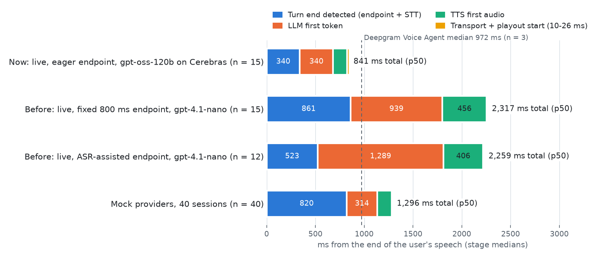

# Latency tuning: 2,317 ms → 841 ms (live, p50)

**Date:** 2026-10-30 UTC. **Machine:** Apple M4, macOS 26.5.2; every process on one laptop, with providers over a residential network. **Metric:** labelled end of the user's speech → first agent sample rendered by the client (`harness/timeline.py::turn_breakdown`, nearest-rank percentiles). **Label:** `live-provider` unless noted. **Small samples** (6–37 per number): these rank configurations; they are not production rates.

**Goal:** bring the live voice turn from 2,317 ms (p50) to about 1,000–1,100 ms, close to the hosted Deepgram Voice Agent's 972 ms (n = 3, [latency_breakdown.md](latency_breakdown.md)).

## Result

Same 15 dev docs questions as the earlier run in [perf.md](perf.md), full stack (headless SDK client → Go gateway → orchestrator → Deepgram / OpenRouter / Cartesia):

| Run | Total p50 / p95 | Turn end detected p50 | LLM first token p50 / p95 | TTS first audio p50 | Transport + playout p50 |
|---|---:|---:|---:|---:|---:|
| Before: fixed 800 ms, gpt-4.1-nano (`wss_live_fixed_20261030T020448Z`, n = 15) | 2,317 / 3,102 ms | 861 ms | 939 / 1,758 ms | 456 ms | 13 ms |
| **After: eager endpoint, gpt-oss-120b on Cerebras** (`wss_live_eager_20261030T132949Z`, n = 15) | **841 / 1,520 ms** | **340 ms** | **340 / 1,013 ms** | **145 ms** | 26 ms |
| After, hard audio: noisy 10/5 dB, slow 0.8×, 600 ms mid-sentence pauses, plain speech (`wss_live_eager_hard_20261030T133436Z`, n = 12) | 841 / 1,218 ms | 340 ms | 366 / 704 ms | 134 ms | 21 ms |

- 13 of 15 docs turns finished under 1,000 ms. The two slow ones were q21, where the LLM's first token took 1,013 ms, and q17, where no punctuated final arrived and the turn fell back to 800 ms of silence.
- The hard-audio clips are LibriSpeech readings, not docs questions, so most answers are refusals. They test endpointing on difficult audio; the stages are measured the same way.
- Deepgram's 972 ms is measured to the first audio frame *received*; ours is to the first sample *rendered*, which is about 10–26 ms later. The baseline has only 3 turns and was not run under matched conditions.

## What changed

| Change | Stage | Before → after (p50) | Where |
|---|---|---:|---|
| LLM `openai/gpt-oss-120b`, OpenRouter provider Cerebras first, reasoning effort low | LLM first token | 939 → 340 ms | `providers/openai_compat_llm.py` |
| One shared HTTP pool with 60 s keep-alive (httpx default is 5 s) and a free `/key` request at session start | LLM first token | (part of the above) | same |
| Cartesia WebSocket opened at session start, before the first answer | TTS first audio | 456 → 145 ms | `server.py::OnDemandTTS.warm`, `cartesia_tts.open_socket` |
| Eager endpoint: Finalize at 200 ms of VAD silence, end the turn on a punctuated final, else after 800 ms | Turn end detected | 861 → 340 ms | `turntaking/floor.py` (`Policy("eager")`), `runtime/session.py` |
| Continuation merge: speech within 2.5 s of an endpoint, before the answer is audible, cancels it and asks the whole question again | (fixes eager's early cutoffs) | — | `runtime/session.py` (`MERGE_WINDOW_US`) |

The Deepgram socket was already opened at session start. The Cartesia credits are still reserved only when the session first speaks, because opening the socket costs nothing.

## Trials

### 1. Which LLM, which provider (text only, no TTS)

`uv run python harness/llm_ttft.py` → [`llm_ttft.json`](llm_ttft.json). The real grounded prompt (`AnswerEngine.messages`, about 1,200 input tokens), 6 questions per config, one warm-up call first.

| Config | First token p50 / max | First sentence p50 / max | Reasoning tokens |
|---|---:|---:|---:|
| gpt-4.1-nano (previous default) | 574 / 2,061 ms | 791 / 2,691 ms | 0 |
| **gpt-oss-120b, Cerebras, effort low** | **300 / 514 ms** | **314 / 538 ms** | 31–77 |
| gpt-oss-120b, Groq, effort low | 451 / 744 ms | 505 / 792 ms | 19–57 |
| gpt-oss-120b, BaseTen, effort low | 508 / 579 ms | 579 / 718 ms | 0 reported |
| gpt-oss-20b, Groq, effort low | 514 / 754 ms | 538 / 768 ms | 14–77 |

Cerebras streams the whole two-sentence answer in about the time nano needs for its first token. Reasoning tokens count against `max_tokens`, so the answer limit went from 80 to 200 (`AnswerEngine`). LLM cost per live turn was $0.00057 median ($0.00025–0.0012 over 29 turns) against $0.00013 for nano. Provider fallbacks are allowed in the shipped adapter, so a Cerebras outage makes turns slower instead of failing; the benchmark pinned Cerebras with no fallback.

### 2. Which endpoint policy (live Deepgram finals, replayed offline)

`uv run python harness/endpoint_study.py --record` streamed 37 dev clips (25 docs questions + 12 LibriSpeech clips) to Deepgram in real time with Silero VAD alongside, sent Finalize after 200 ms of VAD silence, and logged every final with its arrival time. Without `--record`, the log is replayed through each policy at no cost → [`endpoint_study.json`](endpoint_study.json).

| Policy | Delay p50 / p95 | Early cutoffs (of 37) |
|---|---:|---:|
| fixed 300 ms | 360 / 440 ms | 14 |
| fixed 500 ms | 560 / 640 ms | 6 |
| fixed 600 ms | 660 / 740 ms | 3 |
| fixed 800 ms (previous default) | 860 / 940 ms | 0 |
| **eager: punctuated final + ≥ 200 ms silence, else 800 ms** | **400 / 540 ms** | **5** |
| eager, else 600 ms | 400 / 540 ms | 7 |
| eager with 400 ms silence, else 800 ms | 460 / 540 ms | 4 |

Requiring 200, 250 or 300 ms of silence with the final gave identical results, because Deepgram's final arrives about 100 ms after Finalize. Raising it to 400 ms saved one cutoff for 60 ms of median delay. Eager at 200 ms was chosen, with the merge handling the cutoffs.

### 3. Full stack, live

Rows in the Result table. The smoke run before them (`wss_live_eager_smoke_20261030T132832Z`, 2 turns) measured 757 and 859 ms.

## Early cutoffs become merges

With the eager policy, Deepgram sometimes punctuates a pause inside a question ("How do I install uv?" … "On a Mac or Linux machine?"). The turn ends early and generation 1 starts. When the user keeps talking within 2.5 s and before any of that answer is audible, the session:

1. cancels generation 1 (it has not played: in all 6 cases the client acknowledged with `played_until_seq: -1`);
2. puts the earlier text in front of the new transcript;
3. answers the whole question once, as generation 2.

Live, this happened in 6 of 27 turns (q01, q06, q17, dev_single_02, dev_slow_0_8x_02, dev_mid_pause_600ms_01). Each was answered from the complete question, for example q06: "When moving from pip how do I import my requirements? But keep my old pinned versions?". The total is still measured from the end of the *whole* utterance, so a merge costs no reported latency. It costs one extra LLM call. Before this work, `asr_assisted` cut 3 of 15 questions in half and answered each half.

The merge has a known limit. Once the early answer is audible (the client has reported `playout.started`), new speech is a barge-in and a new question, and the first half is not carried over. That is deliberate: a user who says "stop" after hearing the answer should not get the old question glued on. A speaker who pauses that long mid-question hears the start of an answer to half of it. That did not happen in these runs: generation 1's first audio comes about 800 ms after the pause begins (endpoint, LLM, TTS), and in all 6 cases the user resumed sooner.

## Answer quality after the model change

Text-only grounded eval, same questions as [docs_eval.md](docs_eval.md) (`uv run python harness/answer_eval.py --split holdout`):

| Measure | gpt-4.1-nano ([`docs_eval_gpt-4.1-nano.json`](docs_eval_gpt-4.1-nano.json)) | gpt-oss-120b ([`docs_eval.json`](docs_eval.json)) |
|---|---:|---:|
| Refusal decisions right (holdout) | 15 / 15 | 14 / 15: refused q13 "How do I pin the Python version for my project?" with the right passage at rank 1 |
| Answers containing every `must_contain` term | 10 / 11 | 10 / 10 |
| Citations supporting the answer | 15 / 15 | 12 / 12 |
| Adversarial (stale, contradiction, injection, unauthorized, unsupported) | 13 / 15 | 14 / 15 (contradiction 2/3) |
| Adversarial, fresh pages | 6 / 6 | 5 / 6 (contradiction 1/2) |

Comparable within the ±1 noise seen between runs. gpt-oss is a little more cautious: one false refusal, and it answers contradictions from the official page without always saying that another page disagrees. The eval's term check now treats Unicode hyphens like ASCII ones; before that, two correct gpt-oss answers ("free‑threaded", "pure‑Python") were scored as misses.

In the 15 live voice turns, the 3 unanswerable questions were refused and 11 were answered with citations. q16 was refused because Deepgram heard "Where does uvx keep…" as "When it is uvx keep…".

## Cost of this work

From `benchmarks/spend_ledger.json`: LLM study $0.008, endpoint study (STT) $0.037, live end-to-end runs (29 turns) $0.043 and 2,580 Cartesia credits, two answer evals $0.035. Project total afterwards: $0.95 of the $5 cap, 13,692 of the 16,000 planned Cartesia credits.

## Settings and how to reproduce

- Live mode uses the eager policy by default (`python -m voicecore.server --providers live`). Mock mode keeps fixed 800 ms, because the mock STT returns its canned final at every pause.
- Flags: `--policy`, `--llm-model`, `--llm-provider` (`any` lets OpenRouter route), `--llm-reasoning` (`none` for non-reasoning models). Example: `--llm-model openai/gpt-4.1-nano --llm-provider any --llm-reasoning none` restores the previous LLM.
- Runs: `uv run python harness/runner/wss.py --providers live --sequential --tail 8 --clips <ids>`, then `uv run python harness/latency.py <run dir>`. Turns with more than one generation are now counted, measured to the generation that played.
- The runner now stops if its gateway or orchestrator fails to start. The first smoke run silently measured a leftover `docker compose` stack on port 8080.

## Not done

- Speculative LLM calls on partial transcripts would remove most of the remaining 340 ms of endpoint wait, at the cost of more LLM calls; not tried.
- No repeat runs at different times of day. LLM provider latency moved by 2× between batches before (perf.md), so the p95 should be checked again before it is quoted widely.
- The browser widget was not measured live here; it uses the same SDK and server path as the headless client.
